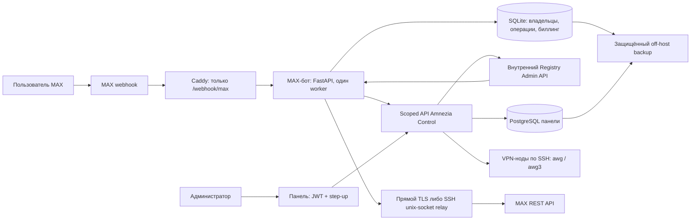

# Cheburnetagonist

MAX-бот самообслуживания VPN и интеграционный слой для управления AmneziaWG-нодами
через [Amnezia Control](https://github.com/MihSergeev/amnezia-control).
Репозиторий — исходная точка дальнейшей модернизации личного VPN-проекта.

**Статус на 2026-11-14:** импорт действующей реализации, а не переписанная новая версия.
Текущий production baseline: бот `v2-guide-pdf`, backend `v2-delete`, frontend `v2-guide-closed`.
Управляющие сервисы перенесены на отдельный manager; DNS bridge и новая co-hosted нода ещё в работе.
Адреса и живые данные не публикуются; [результат cutover](docs/knowledge/MANAGEMENT-CUTOVER-2026-11-14.md).
Примеры IP относятся к RFC 5737; `example.net` — заглушка, а не рабочая инфраструктура.

## Содержание

- [Возможности](#возможности-сейчас)
- [Архитектура](#архитектура)
- [Состав репозитория](#состав-репозитория)
- [Зависимости](#зависимости)
- [Локальная проверка](#локальная-проверка-без-production)
- [Конфигурация](#конфигурация)
- [Развёртывание](#развёртывание)
- [План модернизации](#план-модернизации)
- [Документация и база знаний](#документация-и-база-знаний)

## Возможности сейчас

### Пользователь в MAX

- Саморегистрация: контакт либо ручной номер и имя. Номер, введённый вручную, не считается подтверждённым.
- Привязка доступа к числовому MAX ID; личные диалоги, не групповые команды.
- Список своих профилей, получение `vpn://`, выдача на разрешённых серверах в пределах общей квоты.
- Пауза, возобновление и отзыв только собственных профилей с подтверждением.
- Перевыпуск и перенос: новый профиль, окно переключения 30 минут, затем отзыв старого
  после подтверждения; отмена/истечение сохраняет старый и отзывает новый.
- Отдельный сценарий «ключ скомпрометирован»: сначала отзыв старого, затем новая выдача.
- Покупка лимита: N × 100 ₽ за N слотов на 30 дней с ручным подтверждением владельцем;
  чек/вложение можно передать боту. Legacy-профили не переводятся автоматически на оплату.
- Напоминания об истечении; при нехватке оплаченных слотов — пауза по правилам биллинга,
  последующий отзыв. Полные правила находятся в `billing.py`, не в платёжном провайдере.
- PDF-инструкция; публичная HTML-инструкция исторически закрыта.

### Администратор

- Раздел «Пользователи MAX» в панели: квоты, разрешённые серверы, привязки,
  бесплатный/платный режим, пакеты, журналы, блокировка бота и полный отзыв VPN.
- JWT и step-up панели защищают административные изменения. Бот не получает admin JWT.
- Один SQLite-реестр владельцев; backend панели обращается к нему через внутренний API.
- Удаление пользователя не подменяет отзыв VPN: сначала подтвердить отсутствие действующих профилей.
- Инвентарь нод, очередь операций, диагностика неопределённых исходов, operator-only CLI.

### Чего пока нет

- Автоматического подтверждения платежей и фискализации: `TBankFeed` и `MoyNalogSink` — **заглушки**.
- Автоматического разрешения `unknown` после сетевой ошибки.
- HA, нескольких workers/реплик, безопасной параллельной записи несколькими ботами в один реестр.
- Реализованного Pachca-бота: изучен отдельный исторический roadmap, не подключён транспорт Пачки.
- Вендоринга полного Amnezia Control или движка AmneziaWG: upstream фиксируется commit/digest.
- Обещания бесшовного переноса клиентского ключа между IP: нужен новый конфиг и импорт пользователем.

## Архитектура



Владение профилем проверяет бот; scoped API панели ограничивает набор нод, но не реализует
пользовательскую ownership-модель. `awg`/`awg3` — семейства API и пространства конфигурации,
а не обещание конкретной версии VPN-движка.

## Состав репозитория

```text
apps/max-bot/
  vpnmax/                 # приложение: API, Store, worker, команды, billing, registration
  panel-extension/        # два backend adapter и React/CSS раздела пользователей
  tests/                  # offline suite; contract tests с optional pinned upstream
  deploy/                 # build helpers и исторические operator acceptance scripts
  public-guide/           # HTML-исходник инструкции и исторические Caddy-варианты
  certs/                  # публичный корневой CA MAX, НЕ приватный ключ
infra/
  panel/                  # sanitized Compose/nginx/Caddy baseline upstream
  max-relay/              # systemd и SSH-конфигурация транспорта MAX
  backup/                 # текущая схема off-host backup и systemd timer
tools/legacy/             # импортированные вспомогательные скрипты, не автозапуск
docs/                     # архитектура, эксплуатация, roadmap, решения и knowledge index
scripts/                  # безопасные локальные проверки и pinned upstream checkout
.github/workflows/        # offline CI и проверка секретов; без production deployment
```

`deploy/` и `tools/legacy/` содержат сценарии с намеренно обезличенными адресами и историческими путями.
Это исходный код для анализа/адаптации, **не** готовый универсальный installer. Не запускать acceptance,
register/provision/finalize/rotate против production без проверки параметров и baseline.

## Зависимости

| Уровень | Версии/состав | Назначение |
|---|---|---|
| Runtime бота | Python 3.12; offline также проверяется 3.13 | один async процесс |
| Python direct | FastAPI 0.121.0, HTTPX 0.28.1, Uvicorn 0.38.0 | `apps/max-bot/requirements.txt` |
| Тесты | pytest 8.4.2 | `requirements-dev.txt`; upstream dependencies нужны только contract tests |
| UI/PDF tooling | Node.js 22+, Playwright 1.63.0, Chromium | не runtime бота; отдельный `npm ci` |
| Панель upstream | Amnezia Control baseline 0.84.6, commit `7e0598b950b86f24dfdcff392bd5d8eccdb74f6e` | backend/frontend, не собственный форк движка |
| Панель storage | PostgreSQL 18 по исходному Compose | не хранит второй независимый MAX-реестр |
| Сеть | Docker Engine, Compose plugin с поддержкой `!reset`, Caddy, OpenSSH | изоляция сервисов, TLS, node API и optional relay |
| MAX | отдельный bot token, webhook secret, HTTPS endpoint, доверенный CA | REST и webhook |
| Ноды | установленный AmneziaWG; в исходном контуре tools 3.1 | не обновлять вместе с ботом автоматически |

Транзитивные Python-зависимости пока не зафиксированы отдельным lock-файлом; это P0 roadmap.
Локальный тест не доказывает совместимость с будущим upstream панели.

## Локальная проверка без production

```bash
git clone git@github.com:ultrix4ever/cheburnetagonist.git
cd cheburnetagonist
python3 -m venv .venv
.venv/bin/python -m pip install -r requirements-dev.txt
make test
```

`make` — optional GNU Make. Без него: `cd apps/max-bot && ../../.venv/bin/python -m pytest -q`.

Baseline: **147 passed, 2 skipped**. Два contract-модуля пропускаются без `PANEL_SOURCE`;
это не означает проверенного контракта с живой панелью. Offline tests не используют рабочие токены.

Для contract tests:

```bash
./scripts/fetch-panel-source.sh
# В отдельном окружении установить backend dependencies pinned upstream.
cd apps/max-bot
PANEL_SOURCE="$PWD/../../.cache/upstream/amnezia-control/backend" \
  ../../.venv/bin/python -m pytest tests/test_panel_contract.py tests/test_max_users_contract.py -q
```

Для browser/PDF tools:

```bash
npm ci
npx playwright install chromium
npm run guide:pdf
```

UI smoke scripts требуют заранее собранный frontend с расширениями. Отдельно документируются
offline mock-UI, live UI и реальный VPN-трафик: успешный pytest не заменяет остальные уровни.

## Конфигурация

Полный шаблон: [`apps/max-bot/.env.example`](apps/max-bot/.env.example).
Рабочий `.env` хранить вне checkout, режим 0600. Не `source`-ить его из недоверенных источников.

| Переменная | Что означает |
|---|---|
| `MAX_BOT_TOKEN` | секрет только выделенного MAX-бота |
| `MAX_WEBHOOK_SECRET` | не менее 32 символов; сверка входящего заголовка |
| `MAX_OWNER_ID` | числовой ID владельца для административных уведомлений |
| `MAX_CA_FILE` | дополнительный доверенный CA, TLS verification не отключается |
| `MAX_API_SOCKET` | optional Unix socket для relay; пусто = прямой HTTPS |
| `PANEL_URL`, `PANEL_API_KEY` | внутренний backend и scoped ключ, не admin JWT |
| `PANEL_PROTOCOLS` | JSON map ID ноды → `awg`/`awg3` |
| `DATABASE_PATH` | единственная рабочая SQLite, writable защищённый volume |
| `REGISTRY_ADMIN_SECRET` | отдельный внутренний admin secret, общий backend и боту |
| `PAYMENT_DETAILS`, `PAYMENT_URL`, `PAYMENT_PHONE` | реквизиты из приватного окружения; URL только HTTPS |
| `GUIDE_FILE_TOKEN` | reusable токен заранее загруженного в MAX PDF |

Собственные значения API scopes, MAX IDs, разрешённых IP, доменов и SSH known_hosts задаются при установке.
Готового тестового production аккаунта, платёжных реквизитов и действующих VPN-конфигов в Git нет.

## Развёртывание

1. Зафиксировать состояние панели/нод, сделать PostgreSQL dump и SQLite backup API, проверить копию.
2. Получить pinned upstream, подготовить расширения через `deploy/prepare_v2.py`, собрать frontend/backend.
3. Вынести секреты и writable volumes за пределы checkout. Подключить отдельный scoped API-ключ.
4. Использовать один worker, UID 10001, read-only rootfs, cap_drop, resource limits; не публиковать bot/admin ports.
5. Caddy пропускает только точный webhook. Панель остаётся под ACL; internal admin API наружу не направляется.
6. Если прямой MAX недоступен, настроить ограниченный SSH unix-socket relay с закреплёнными host keys.
7. Поднять бота в существующей Docker-сети панели; зарегистрировать единственный согласованный webhook.
8. Проверить health, API, ACL, очередь, ownership, отдельный тестовый VPN-туннель и очистку тестов.
9. Включить off-host backup и сверить восстановление, затем зафиксировать release и rollback.

Подробности: [deployment](docs/DEPLOYMENT.md), [operations](docs/OPERATIONS.md).
Push в main **не деплоит** ни бота, ни панель, ни VPN-ноды. Этот импорт не меняет production.

## План модернизации

Полная очередь с критериями приёмки: [ROADMAP.md](docs/ROADMAP.md).

| Этап | Приоритет | Результат |
|---|---|---|
| 0. Baseline и Git | P0, текущая работа | исходники, документация, CI, отсутствие рабочих данных |
| 1. Воспроизводимость | P0 | lock-файлы, единый build/deploy manifest, contract job с pinned upstream, staging |
| 2. Эксплуатация | P0 | readiness/метрики очередей/relay/нод, backup retention и полный restore drill |
| 3. Безопасность изменений | P1 | поддерживаемая ОС relay, ротация ключей, migration checks, аудит и recovery unknown |
| 4. Продукт MAX | P1 | надёжные сценарии регистрации, оплаты, PDF и сроков; понятные ошибки и статус |
| 5. Платежи | P2, отдельное решение | официальный adapter, идемпотентность, sandbox; ручной путь сохраняется |
| 6. Дополнительные каналы | P2, необязательное | изолированный Pachca-сервис только после продуктовых решений |
| 7. Масштабирование | после метрик | capacity, координация записей/задач, затем решение о HA, не просто replicas=2 |

Порядок — предложение по результатам аудита, не согласованные сроки и не разрешение на массовые изменения.
Первым делом сохраняем работающие ownership, квоты, биллинг и неизвестные исходы; переписывание
всего проекта или смена панели без доказанной необходимости не является целью.

### Что взято из найденного roadmap

Изученный документ 2026-11-11 описывал **отдельный корпоративный Pachca VPN Bot**, не модернизацию MAX.
Полезные идеи: approval workflow, offboarding, повторная проверка идентичности, request state machine,
изоляция пространств, дедупликация событий и приёмка реальным трафиком.
MAX уже имеет биллинг и личную модель доступа: их нельзя заменять корпоративной моделью без решения.
Оригинал содержит приватную корпоративную информацию и в публичный Git не включён;
обезличенный разбор: [ROADMAP-REVIEW.md](docs/ROADMAP-REVIEW.md).

## Документация и база знаний

- [Индекс знаний](docs/knowledge/INDEX.md) — что читать перед изменениями.
- [Архитектура и границы](docs/ARCHITECTURE.md), [модель данных](docs/DATA-MODEL.md).
- [Эксплуатация](docs/OPERATIONS.md), [зависимости](docs/DEPENDENCIES.md), [развёртывание](docs/DEPLOYMENT.md).
- [Roadmap](docs/ROADMAP.md), [разбор старого roadmap](docs/ROADMAP-REVIEW.md), [решения](docs/DECISIONS.md).
- [Baseline и границы проверки](docs/knowledge/BASELINE-2026-11-14.md), [происхождение импорта](docs/IMPORT.md).
- [Правила работы с секретами](SECURITY.md), [вклад и тесты](CONTRIBUTING.md), [upstream и лицензии](THIRD_PARTY.md).

В публичном Git — код и обезличенные знания. Live topology, доступы, пользовательские записи,
чеки, конфиги, дампы и raw memory остаются в приватном эксплуатационном контуре.
